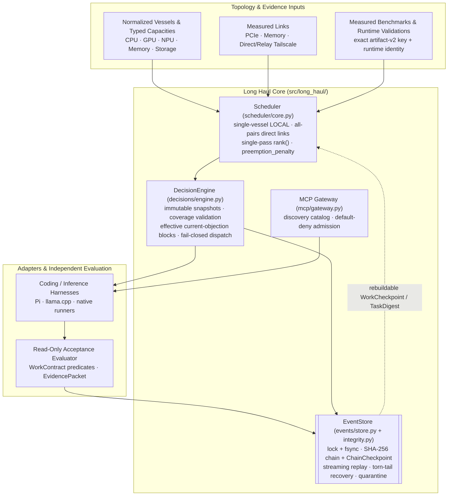

# Long Haul MVP Architecture

> Status: current MVP architecture, hardened core guarantees, and near-term plan as of 2026-11-27.

Long Haul separates institutional identity from hardware and model embodiment. This document defines the current MVP architecture; the standards-first shared-epistemic and heterogeneous-execution direction is diagrammed in [North-Star Architecture](north-star.md).

## Design philosophy and architecture overview

Long Haul favors a **small, deterministic, standards-aligned core** where hardware adapters, LLM harnesses, and future reason-maintenance backends remain replaceable edges:

- **Fail closed on missing evidence:** Unknown capacities, conflicting runtime validations, missing pairwise direct Tailscale links, unauthenticated MCP dispatch, and unwired consequential decision dispatch all fail closed rather than guessing defaults.
- **Keep history immutable and verifiable:** Authoritative events remain human-readable JSONL protected by cross-platform file locking, `fsync`, SHA-256 hash chaining, and explicit trusted checkpoints.
- **Separate exploration from authority:** A worker or model session can propose work and gather diagnostics, but external evaluators and explicit policy gates determine acceptance.

## Core entities

- **Crew member**: persistent operational identity, role, authority scope, competence history, relationships, and continuity record.
- **Embodiment**: current model/runtime/vessel/resource combination implementing a crew member.
- **Vessel**: physical device or host, represented by a normalized manifest.
- **Resource**: CPU, GPU, NPU, memory, storage, sensor, or other individually addressable component. Capacity is typed; unlike capacities are never summed implicitly.
- **Link**: measured relationship between resources or vessels (PCIe, memory, Tailscale, Ethernet, etc.).
- **Mission**: unit of work with objectives, constraints, and outcome metrics.
- **Work contract**: a bounded engineering task derived from a mission, with explicit repository scope, capabilities, budgets, external success predicates, failure predicates, and optional execution-plan linkage. It is not a model prompt or a crew identity.
- **Decision**: structured proposal with independently captured positions and an explicit resolution mode.
- **Execution plan**: mapping from a mission to crew, vessels, resources, runtimes, and execution mode.
- **Model artifact**: compositional foundation/revision/quantization plus optional adapters and auxiliary artifacts; never crew identity.
- **Inference profile**: validated runtime + strategy + artifact + named resources. Resident, split, offloaded, parallel, and streaming approaches are strategies, not execution modes.

## Hard invariants

1. Crew identity is not a model checkpoint or process ID.
2. Aggregate memory is never treated as uniform memory without topology evidence.
3. Model size does not confer rank or authority.
4. Consequential decisions preserve independent initial judgments before deliberation when feasible.
5. Dissent is a protocol state, not a logging accident.
6. Permissions and authority are explicit and externally enforced.
7. Higher-priority safety/cooperation constraints cannot be compensated away by throughput gains.
8. Cross-node PIPELINE execution is eligible only when the measured network path meets policy requirements.
9. Tailscale is the authenticated transport plane; application protocols remain ordinary network services.
10. Every material decision and embodiment transition is provenance-bearing and replayable.
11. Model feasibility follows a validated inference profile over measured topology, not nominal size or aggregate VRAM.
12. Engineering completion is determined by external predicate evidence; model or harness self-report cannot satisfy a work contract.

## Example fleet topology

The public examples model a fixed station with potentially asymmetric accelerator paths and a portable ARM64 edge vessel. Benchmarks, rather than nominal device equality, determine split ratios. Cross-node execution must degrade gracefully when a direct link is lost. Concrete operator manifests and measurements are held in private Fleet.

## Initial crew

### NAV-01 / Mako

Navigator. Proposes execution plans and routes work.

### ENG-01 / Patch

Engineer. Evaluates hardware/runtime feasibility, memory fit, and topology constraints.

The MVP experiment compares this two-role consent/dissent architecture against simpler baselines.

## Execution modes

- `LOCAL`: one vessel, one or more local resources.
- `POOL`: independent work distributed among vessels.
- `PIPELINE`: one model split across resources/nodes when necessary for capability.
- `COMPOSE`: specialist crew/models cooperate on one task.

## Control flow

1. Discover/refresh fleet telemetry.
2. Build candidate execution plans.
3. NAV-01 independently ranks candidates.
4. ENG-01 independently checks constraints and ranks/objects.
5. Store both initial positions before cross-exposure.
6. Apply the decision protocol: consent, stand-aside, objection integration, bounded experiment, scoped authority, escalation, or recorded disagreement.
7. Execute an eligible plan.
8. Record outcome, performance, calibration, dissent, and repair data.
9. Update competence/trust statistics from observed results rather than rhetoric.

### Decision snapshot boundary

The decision prototype returns a new immutable snapshot from each capture,
final-position update, and resolution; callers must retain that returned value.
Positions and their evidence collections are immutable as well. A local
snapshot or resolution event does not prove independent input contexts or an
authorized objection disposition. The standalone consequential-dispatch helper
therefore refuses execution until the event-backed lifecycle and actual runtime
authorization are integrated. Direct access to a snapshot is not an isolation
boundary, and an unchecked model copy is not trusted authorization evidence.
The prototype does not accept early-capture exceptions until those exceptions
have an authenticated, bounded and replayable authority path.

## Work-contract boundary

Long Haul owns task objective, scope, authority, budgets, success/failure predicates, provenance, and final disposition. A coding harness such as Pi is an execution adapter: it may render model-specific guidance and recover from provider-specific failures, but it does not redefine contract success. Work-contract events link creation, attempts, evidence, and disposition so later checkpointing and independent evaluation can reconstruct the history.

The MCP gateway exposes a discovery catalog. Each invocation currently returns
an authorization refusal before reaching an adapter. Contextual authorization
and durable audit intent must be integrated before the gateway can dispatch.

## Independent acceptance evaluation

Repository tasks add the explicit [frozen evaluator projection](repository-evaluation.md): evaluator-owned public/sealed checks resolve exact predicate references, execute an immutable read-only candidate, and retain typed invalid outcomes separately from negative task results. Docker/OCI plus pinned gVisor provides the replaceable sandbox adapter; its strict hosted qualification remains distinct from ordinary fixture tests.

Implementation-time checks are worker feedback, not acceptance evidence. Independent evaluators receive a candidate through a read-only target interface, execute or inspect the WorkContract predicates, and emit an `EvidencePacket` bound to the exact candidate fingerprint plus evaluator/runtime identity. Evidence for an older fingerprint is stale and cannot certify a changed candidate. A later packet may record regressions against prior verified predicates without rewriting the historical packet. Mutation authority is absent from the evaluator interface rather than prohibited only by prompt text.

## Progress and recovery

Long Haul classifies harness steps independently of model prose as information acquisition, state change, verification, recovery, or no-progress. Deterministic action signatures and failure-pair fingerprints permit bounded detection of repeated reads/calls/failures. Successful verification is allowed to repeat without being treated as idle work. Material progress resets the no-progress budget. Interventions are explicit provenance-bearing events containing counters and opaque signatures rather than prompt/tool payloads; exhausting the configured budget can hand the attempt back for checkpoint, retry, or later escalation.

## Persistence

The MVP uses append-only JSONL events (`src/long_haul/events/store.py` and `src/long_haul/events/integrity.py`) plus materialized views. SQLite remains an optional future index; event provenance remains exportable and human-readable.

- **Streaming replay and recovery (`#288`):** `EventStore.read_replay()` streams line-by-line without full-file duplication and reports typed `ReplayDiagnostic` / `ReplayError` locations (path, 1-based line, byte offset, event ID, reason). An unterminated trailing write is surfaced as `incomplete_tail` in inspection mode without mutating the file, blocks strict replay and ordinary appends, and can be explicitly recovered via `recover_torn_tail()` (archiving original damaged bytes). Unknown `event_type` values and unsupported `schema_version` records are quarantined in inspection/export without gaining operational authority, and missing crew references raise typed `ReplayError` rather than raw `KeyError`.
- **Write locking and hash-chain integrity (`#289`):** Appends serialize local threads and processes across the full read-tail → validate → sequence → write → `flush()` → `os.fsync()` critical section (`fcntl.flock` on POSIX, `msvcrt.locking` on Windows; network filesystems remain unqualified). New logs record `log_id`, monotonic `seq`, `prev_hash` (genesis-bound), and canonical SHA-256 `event_hash`, verified via `verify_chain(anchor=...)` against an independent `ChainCheckpoint` while keeping legacy unchained logs readable as `legacy_unverified`.

### Dynamic resources and leases

Persistent vessels need no lease. Ephemeral and externally managed vessels carry a provider-neutral `ResourceLease` with its identity, acquisition/expiry window, preemption and renewal support, trust domain, state-durability claim, and optional cost metadata. Admission, renewal, disappearance, and work-attempt transitions are recorded in the append-only event store and rebuilt into fleet and mission state. Lease metadata describes compute availability; mission and attempt continuity remains in Long Haul's durable event history.

When an admitted resource disappears, attempts bound to that lease become inconclusive and the mission is marked for replanning. `lease_lost` and `runner_interrupted` remain separate from `execution_timeout`: a task timeout is an execution outcome, while lease loss says the host stopped being available before Long Haul received an outcome. The scheduler excludes leases that have not started or have expired, can prefer preemptible capacity for explicitly restartable missions, and rejects it when mission continuity policy forbids preemption. Provider-specific allocation and notification details belong behind adapters.

### Work checkpoints and session context

Repository tasks use the optional [repository-work extension and bounded context manifest](repository-work.md). Exact source/task/environment/context identities supplement WorkContract without granting authority. Immutable Git reads, shared resource-policy admission, explicit omissions, and event-derived context summaries are implemented; sealed evaluator and sandbox qualification remain separate gates.

The event log is authoritative history. A `WorkCheckpoint` is a deterministic compact materialization of contract-scoped facts, active constraints, subgoal state, unresolved failures, and the last externally verified artifact; it is disposable and rebuildable from events. A `TaskDigest` is a hard-bounded rendering of that checkpoint for a new harness/model session and explicitly reports omissions. A harness conversation is transient execution context, not durable memory. Resuming work creates a new session identity while retaining the work contract, crew identity, execution-plan linkage, and checkpoint provenance. Crew memory/continuity remains a separate institutional concern and must not be inferred from a model session transcript.

## Hardware boundary

The core consumes normalized vessel, resource, link, and benchmark records. Discovery and runtime adapters are edge protocols; fixture data is conspicuously marked simulated and is never a measurement. Hardware access therefore validates probes and produces evidence without redesigning the core.

## Scheduler admission and evidence reuse

Capacity amounts must be finite, nonnegative, and paired with compatible units. Memory and storage convert from bytes, MiB, or GiB through the same binary conversion. Each resource has at most one capacity entry per kind; repeated profile requirements are independent lower bounds whose maximum applies. Neither resource capacities nor shared RAM/VRAM are summed.

Scheduler callers supply current runtime identities explicitly. Feasibility requires one distinct validation matching the runtime, complete artifact identity, resource placement, strategy, and options. Artifact keys use a versioned hash of all declared components, preserving adapter and auxiliary-artifact order. Historical keys remain readable but cannot certify the new identity. Conflicting current identities or validations fail closed.

Performance reuse additionally requires an exact workload including token counts and cold/cache state, an explicit timezone-aware evidence cutoff, exact profile and placement, successful measured provenance, current runtime identity, and finite nonnegative metrics with a decode-throughput measurement. The scheduler defines no global TTL. Exactly one distinct compatible observation may influence ranking; duplicate identical payloads (excluding record ID) collapse deterministically. Multiple distinct observations retain uncertainty pending an explicit aggregation/sample policy. This is a performance observation, not statistical qualification, task correctness, latency-objective achievement, or authority.

A feasible candidate with no reusable performance evidence may still be selected for exploration, with the uncertainty reason retained. Historical store queries retrieve records without certifying them; failed, legacy-unbound, and non-comparable records remain in history and receive no favorable ranking. Invalid historical capacity encodings fail schema admission without rewriting source records.

Acceptance packets and direct work evaluations require unique predicate IDs within each attempt. Identical and conflicting duplicates both raise validation errors; observations in independent attempts remain separate history.

Multi-vessel execution modes obey strict topology semantics (`#286`, `#292`): `LOCAL` requires exactly one vessel matching the profile's derived resources, and `generate()` never emits multi-vessel `LOCAL`. Whenever `plan.mode` is `PIPELINE`, `mission.requires_synchronous_cross_node` is true, or `profile.synchronous_cross_node` is true, **every** unordered vessel pair must have a measured direct Tailscale link (`kind == "tailscale"`, `direct == True`, `path == "direct"`, `measured == True`), regardless of the outer mode label. Independent `POOL` on a relayed link and single-vessel multi-GPU `LOCAL` profiles remain supported. `rank()` materializes its input once so generators are safe, clears stale ranks on ineligible plans, and orders eligible candidates by `(-measured, preemption_penalty, -continuity, -throughput)` with deterministic lexical `plan_id` tie-breaking.

## Current state and near-term plan

| Subsystem | Current State (2026-11-27) | Next Milestones |
| --- | --- | --- |
| **Scheduler** | Hardened (`#286`, `#292` closed): topology/link policy enforced across all modes and pairwise edges; single-pass `rank()`. | Add explicit bounded exploration alongside measured candidates (`#287`). |
| **EventStore** | Hardened (`#288`, `#289` closed): streaming replay, torn-tail recovery, schema quarantine, write locking, `fsync`, and SHA-256 hash chaining with trusted `ChainCheckpoint` anchors. | Broader duplicate/idempotency audit (`#280`) and optional SQLite read index. |
| **DecisionEngine** | Immutable snapshots, unique/complete coverage validation, effective-block checks, and fail-closed dispatch landed (`#330`). | Integrate event-backed objection lifecycle, authenticated exceptions, and live consequential runtime wiring (`#290`). |
| **MCP Gateway** | Default-deny policy admission merged (`#307`). | Add positive Cedar authorization and durable audit trail (`#294`, `#16`). |
| **Developer & CI tooling** | Bare `pytest` collection and `posix_only` platform markers landed (`#319` closed); full POSIX suite runs on `ubuntu-24.04` CI, platform-neutral & Windows discovery tests pass natively on Windows. | Harden empirical experiment harness (`#291`) and evaluator candidate limits (`#293`). |
